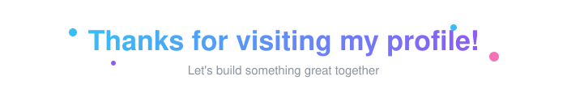

  

  

---

## 👨‍💻 About me

- 🎓 Digital Development student (Web Full Stack) @ **ISTA Hay Salam**, Salé 🇲🇦
- ⚛️ Front-end: **React.js**, **Bootstrap**, HTML, CSS, JavaScript
- 🐘 Back-end: **Laravel (PHP)** and **SQL**
- 📋 Agile / Scrum with **Jira**
- 🌱 Currently looking for an **internship** to grow and ship real projects

## 🛠️ Tech Stack

 

## 🚀 Projects

<table>
<tr>
<td align="center">

</td>
<td align="center">

</td>
</tr>
<tr>
<td align="center">

</td>
<td align="center">

</td>
</tr>
</table>

## 📊 Activity

  

